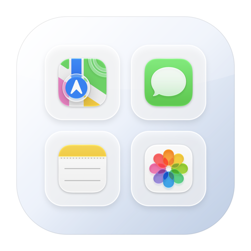

# DockGroup

[](https://www.gnu.org/licenses/gpl-3.0)
[]()
[]()

把一组 app 放进 **Dock 左侧**，点一下展开成面板。

macOS 的 Dock 左侧只认 `.app`，文件夹堆栈只能待在右侧、而且绑定硬盘上的真实文件夹。DockGroup 给每个「组」生成一个占位 app 塞进左侧应用区，点击弹出网格面板 —— 组里可以放 app、文件、文件夹和网页，不用在硬盘上建任何目录。



## 为什么需要它

Dock 左侧放不了文件夹，右侧堆栈又只认单一目录。想把「设计工具」「开发工具」「今天要用的一堆文件」各自打包成一组、还留在左侧 app 区域，系统本身做不到。

DockGroup 补的就是这一块。

## 功能

- **组图标在 Dock 左侧**，和普通 app 并排，不占右侧堆栈位
- **图标预览**：组图标自动合成组内前 4 项的缩略图，一眼看出里面是什么
- **网格面板**：点击组图标弹出面板，图标网格排布，按 app 真实图标显示
- **文件夹就地展开**：面板里点文件夹，直接在下钻层级浏览文件，不跳 Finder
- **子组嵌套**：一个组可以引用另一个组，面板内逐层下钻，顶部有返回
- **窗口随内容自适应**：1 项 268×190，8 项 372×286，超过 5 行封顶并滚动
- **中文名**：读系统元数据取访达显示名（`Maps` → `地图`），也可手动改
- **液态玻璃界面**：macOS 26/27 用系统 `glassEffect`，更早系统自动回退材质
- **安全**：同步前自动备份 `com.apple.dock`，可一键移除全部组、从备份恢复

## 安装

### 方式一：下载构建好的 app

从 [Releases](../../releases) 下载 `DockGroup.zip`，解压后把 `DockGroup.app` 拖进「应用程序」。

首次打开会被 Gatekeeper 拦（未公证的 ad-hoc 签名），右键 → 打开，或：

```bash
xattr -dr com.apple.quarantine /Applications/DockGroup.app
```

### 方式二：从源码构建

需要 Xcode Command Line Tools（`xcode-select --install`）与 Swift 5.9+。

```bash
git clone https://github.com/你的用户名/DockGroup.git
cd DockGroup
./build.sh
open dist/DockGroup.app
```

`build.sh` 会编译 release 二进制、按需重新生成应用图标、组装 `.app`、ad-hoc 签名并注册到 LaunchServices。

## 使用

1. 打开 `DockGroup.app`，设置窗口自动出现（主程序不常驻、无 Dock 图标）。
2. 点「＋」新建组，改名。
3. 「添加应用 / 添加文件」选项目，或直接把文件拖进列表；「添加网页」存 URL。
4. 点「同步到 Dock…」→ 确认 → Dock 重启，左侧出现组图标。
5. 点组图标弹面板；点面板外、按 Esc、或切走焦点都会关闭。

面板右上角「编辑」回到设置窗口。菜单栏图标默认关闭，可在设置里打开。

### 卸载

设置窗口点「从 Dock 移除所有组」，然后删掉 `DockGroup.app`。残留数据在：

```bash
rm -rf ~/Library/Application\ Support/DockGroup
defaults delete local.dockgroup.main   2>/dev/null
defaults delete local.dockgroup.shared 2>/dev/null
```

## 原理

三件事：

1. **占位 app**：每个组生成一个最小 `.app` 放在 `~/Library/Application Support/DockGroup/Stubs/<组ID>.app`，写组名、组图标，并把组 ID 一起打进去。
2. **写入 Dock**：编辑 `com.apple.dock` 的 `persistent-apps`（应用区），只追加自己的条目，不动其余图标与设置；重启 Dock 生效。改动前把整份 plist 备份到 `Backups/`。
3. **点击直通**：占位 app 里内嵌主程序的二进制副本。点击时它读同目录下的组 ID，认出自己该弹哪个组，直接渲染面板，不进主程序、不绕 URL scheme。

第 3 点是这个项目和同类工具的主要差异：省掉了「占位 app → URL scheme → 主程序」的往返，也省掉必须常驻一个后台进程。

## 性能

本机 macOS 27.0.1 / M3 Max 实测：

| 指标 | 数值 |
|---|---|
| 点击到面板出现（冷启动） | 141–232 ms |
| 面板自身渲染 | 28–35 ms |
| 进程内存 footprint | 21 MB（面板打开 22 MB） |
| 空闲 CPU | 0.0%（累计 0.69 s） |
| 后台常驻 | 无（面板关闭即退出） |
| 每个占位 app 磁盘 | 约 1.1 MB |

设置里可打开「面板关闭后保留后台 3 分钟」，二次点击降到 38 ms，代价是多一个 21 MB 的空闲进程。

## 已知限制

- **面板定位**：按鼠标位置对齐，未使用辅助功能 API，图标很多时可能不完全贴齐 Dock 图标。
- **路径失效**：组内项目存绝对路径，文件移动或改名后条目会失效，需重新添加。
- **不能拖到图标**：只能拖进设置窗口的列表，不支持把 app 拖到 Dock 图标上直接加入。
- **界面仅中文**。
- **无自动更新**，升级需手动替换并重新同步。
- **会重启 Dock**：同步和图标变更时会结束 Dock 进程让系统重建，屏幕上的 Dock 会短暂消失。
- **arm64 + macOS 13+**，未做 Intel / 通用二进制。

## 兼容性

| 系统 | 界面 | 状态 |
|---|---|---|
| macOS 26 / 27 | 液态玻璃（`glassEffect`） | 主力测试环境 |
| macOS 13–15 | 材质回退（`.regularMaterial`） | 可编译，未实测 |

## 声明

本项目为独立实现，**未使用、未引用、未修改 [Flotilla](https://github.com/rakuyoMo/Flotilla) 的任何源代码**，因此不继承其任何许可义务。功能定位相近，是因为两者针对同一个 macOS 系统限制。

本项目采用 GPLv3 是作者的独立选择，与 Flotilla 无关；双方许可相同不代表任何代码关联。

项目零第三方依赖，仅使用系统框架：AppKit、SwiftUI、Combine、CoreServices、CoreGraphics。

## 许可证

本项目以 **GNU General Public License v3.0** 发布，全文见 [LICENSE](LICENSE)。

```
Copyright (C) 2026 DockGroup contributors

This program is free software: you can redistribute it and/or modify
it under the terms of the GNU General Public License as published by
the Free Software Foundation, either version 3 of the License, or
(at your option) any later version.

This program is distributed in the hope that it will be useful,
but WITHOUT ANY WARRANTY; without even the implied warranty of
MERCHANTABILITY or FITNESS FOR A PARTICULAR PURPOSE.  See the
GNU General Public License for more details.
```

可以自由使用、修改、分发，前提是衍生作品同样以 GPLv3 发布并提供完整对应源码。本仓库即完整源码，`./build.sh` 可复现 `dist/DockGroup.app`。

> GPLv3 与 Mac App Store 的发行条款不兼容。若需上架，须另行取得版权持有人的额外授权。
